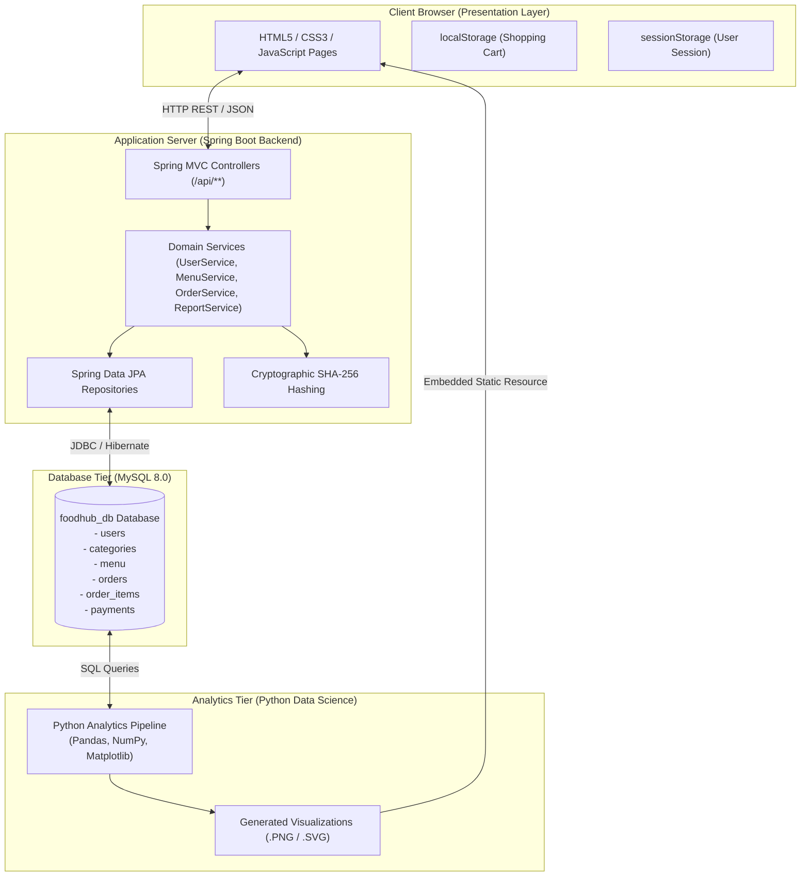
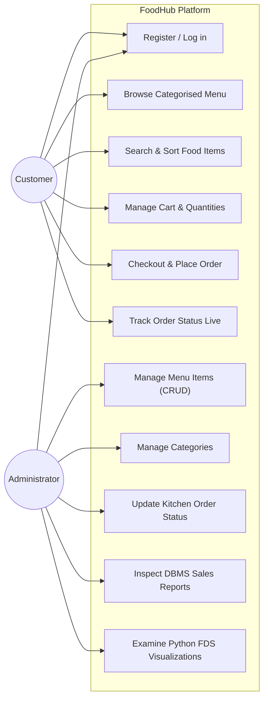
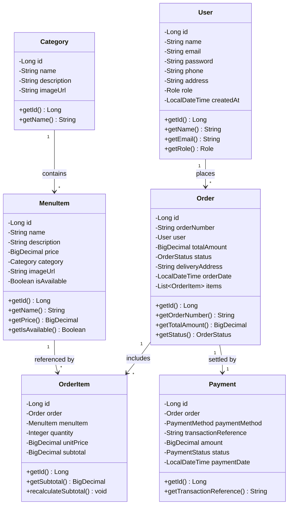
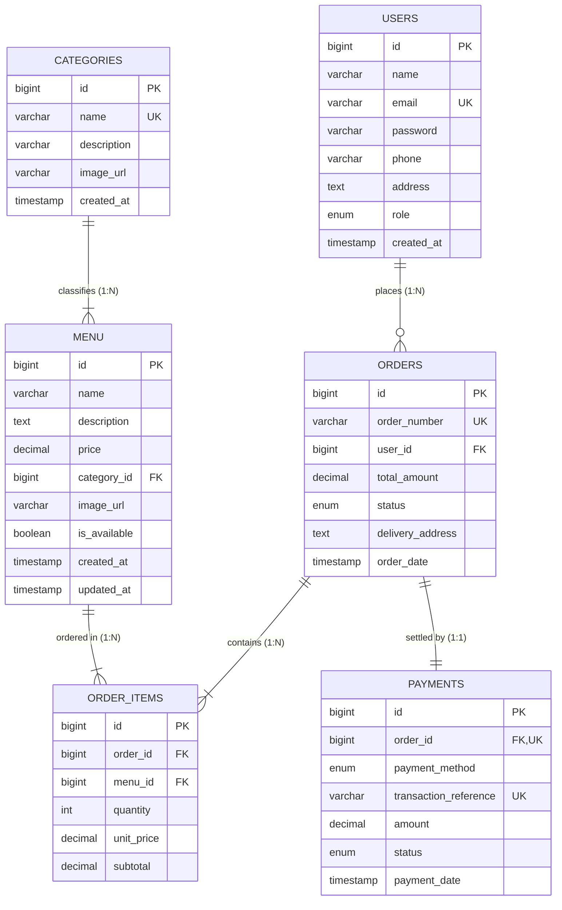
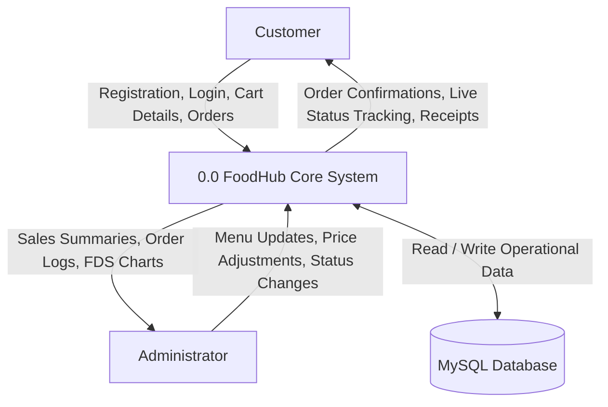
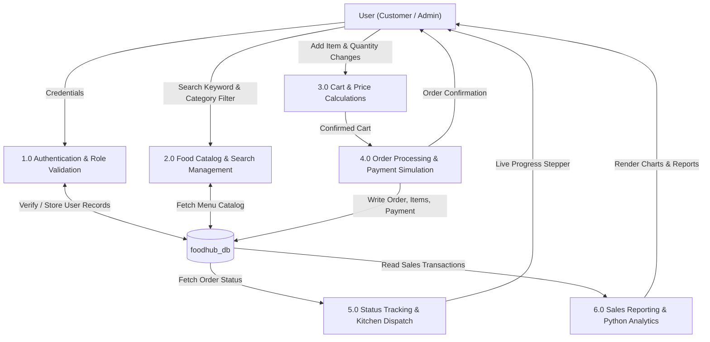
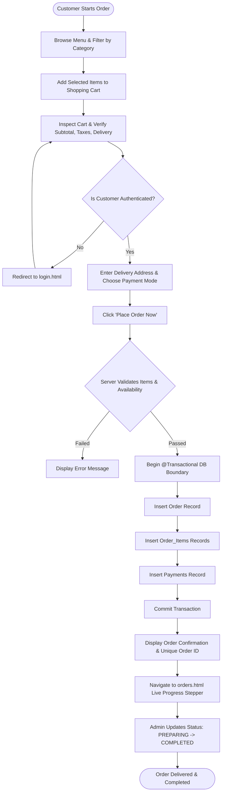

# FoodHub Software Engineering Diagrams
## Visual Models & Architectural Blueprints

This document provides formal software engineering diagrams in Mermaid syntax.

---

### 1. System Architecture Diagram

---

### 2. Use Case Diagram

---

### 3. Class Diagram

---

### 4. Entity-Relationship (ER) Diagram

---

### 5. Data Flow Diagram (DFD) Level 0 – Context Diagram

---

### 6. Data Flow Diagram (DFD) Level 1

---

### 7. Order Placement & Fulfillment Flowchart

